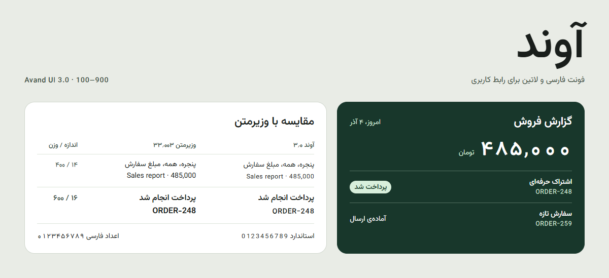

<div dir="rtl">

# آوند ۳٫۰

آوند فونت فارسی و لاتین برای رابط کاربری است که بر پایه‌ی وزیرمتن ساخته شده و پیش‌تر با نام «ویرا» منتشر می‌شد. در این نسخه هر دو خانواده‌ی «آوند» و «آوند اعداد فارسی» به‌صورت متغیر و ثابت برای نصب روی سیستم و استفاده در وب عرضه می‌شوند.

[سایت و آزمایش فونت](https://qmahmoudi74.github.io/vira/) · [دانلود آخرین نسخه](https://github.com/qmahmoudi74/vira/releases/latest) · [راهنمای نصب و وب](docs/INSTALL.md) · [تاریخچه‌ی تغییرات](FONTLOG.txt)



## نسخه‌ها

| خانواده | نمایش رقم‌ها | فایل‌های فونت |
| --- | --- | --- |
| `Avand UI` | رقم‌های لاتین، فارسی و عربی هر کدام شکل خودش را دارد. | `TTF` و `WOFF2`، متغیر و ثابت |
| `Avand UI FaNum` | رقم‌های لاتین و عربی با شکل فارسی نمایش داده می‌شوند. | `TTF` و `WOFF2`، متغیر و ثابت |

هر خانواده وزن‌های ۱۰۰ تا ۹۰۰ را دارد. نسخه‌ی متغیر یک فایل برای تمام وزن‌هاست و نسخه‌ی ثابت برای هر وزن فایل جداگانه دارد. در نسخه‌ی اعداد فارسی، متن و کد یونیکد رقم‌ها هنگام کپی یا پردازش حفظ می‌شوند.

## تفاوت با وزیرمتن

- کاسه‌ی «ه» و «م» در چند فرم بازطراحی شده و فاصله‌ی رقم‌های فارسی و متن آمیخته‌ی فارسی و لاتین بازبینی شده است.
- تنظیم‌های TrueType برای اندازه‌های ۱۴ و ۱۶ پیکسل فیزیکی در ویندوز از ویرا ۲٫۱ به این نسخه آمده‌اند. حاصل رندر به سیستم، مرورگر و نمایشگر هم بستگی دارد.
- در نسخه‌ی ۳٫۰ نام خانواده‌ها به آوند تغییر کرده است. مسیر حروف، فاصله‌گذاری و داده‌های وزن از ویرا ۲٫۲ حفظ شده‌اند.

برای مقایسه، `Preview.html` را از بسته‌ی کامل خارج و در مرورگر باز کنید. صفحه آفلاین است و متن یکسان را در اندازه‌های ۱۴ و ۱۶ پیکسل و وزن‌های ۴۰۰ و ۶۰۰ نمایش می‌دهد. وزیرمتن و آوند در صفحه تعبیه شده‌اند. برای ایران‌سنس، یکان‌بخ و دانا می‌توانید از فونت نصب‌شده یا فایل فونت خود استفاده کنید.

## دانلود و نصب

| بسته | محتوا |
| --- | --- |
| `Avand-3.0.0.zip` | همه‌ی فونت‌ها، مقایسه‌ی آفلاین، تصویر نمونه و راهنما |
| `Avand-3.0.0-Desktop.zip` | فایل‌های `TTF` برای ویندوز، مک و لینوکس |
| `Avand-3.0.0-Web.zip` | فایل‌های `WOFF2` و CSS آماده‌ی هر دو خانواده |

برای نصب روی سیستم، فایل متغیر یا مجموعه‌ی وزن‌های ثابت همان خانواده را انتخاب کنید. مسیر نصب هر سیستم در [راهنمای نصب](docs/INSTALL.md) آمده است.

## ساخت از سورس

فایل [`source/Vira.ttx`](source/Vira.ttx) ورودی قابل‌ویرایش TrueType به‌جامانده از ویرا است و مسیر حروف، داده‌های متغیر، جدول‌های شکل‌دهی و دستورهای هینتینگ را در خود دارد. اسکریپت ساخت، نسخه‌ی استاندارد و اعداد فارسی، وزن‌های ثابت، CSS و صفحه‌ی مقایسه را از همین ورودی و دارایی‌های مقایسه تولید می‌کند.

</div>

```sh
python -m pip install -r requirements.txt
python scripts/build.py
python scripts/verify.py
python scripts/package.py
```

<div dir="rtl">

## اعتبار و مجوز

آوند نسخه‌ای تغییر‌یافته از [وزیرمتن ۳۳٫۰۰۳](https://github.com/rastikerdar/vazirmatn/tree/v33.003)، اثر صابر راستی‌کردار و مشارکت‌کنندگان پروژه‌ی وزیرمتن، و منتشرشده در حساب [`qmahmoudi74`](https://github.com/qmahmoudi74) است. حروف لاتین از [Roboto Variable 3.004](https://github.com/googlefonts/roboto-3-classic/tree/v3.004) به ارث رسیده‌اند. فونت با [SIL Open Font License 1.1](OFL.txt) منتشر می‌شود و [مجوز و اعتبار Roboto](licenses/NOTICE.txt) همراه آن است.

</div>
